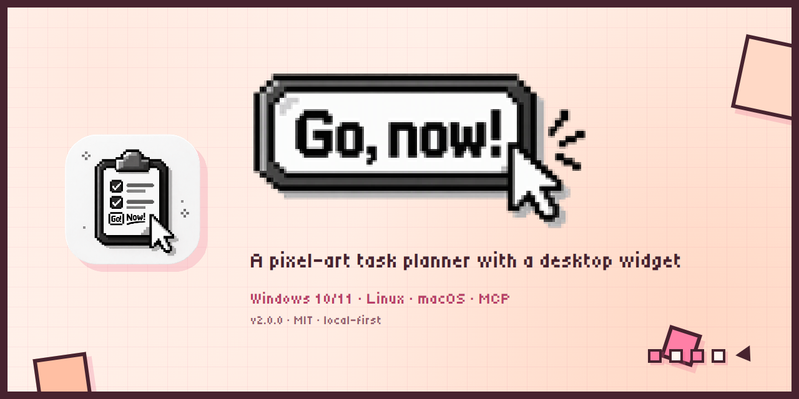
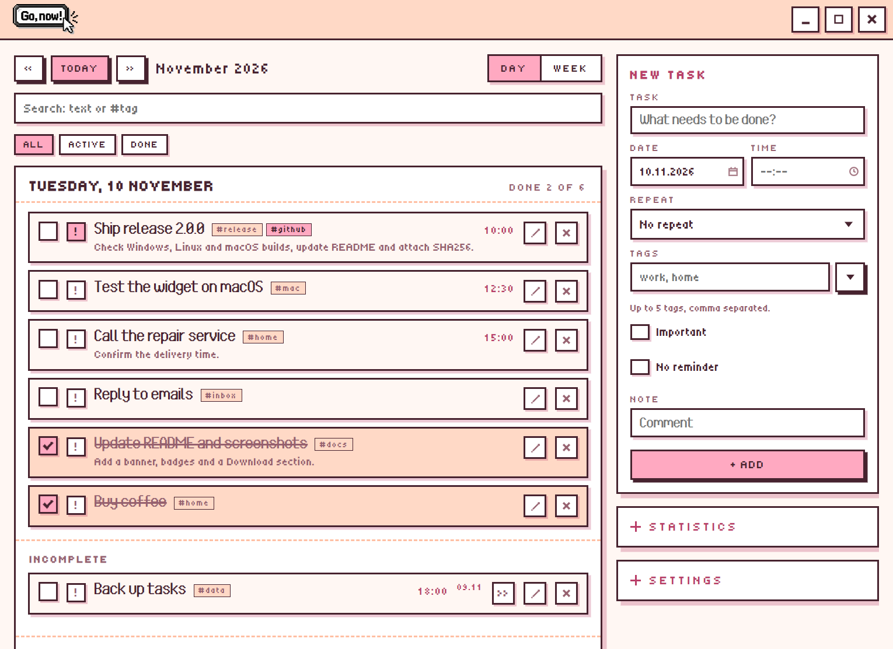
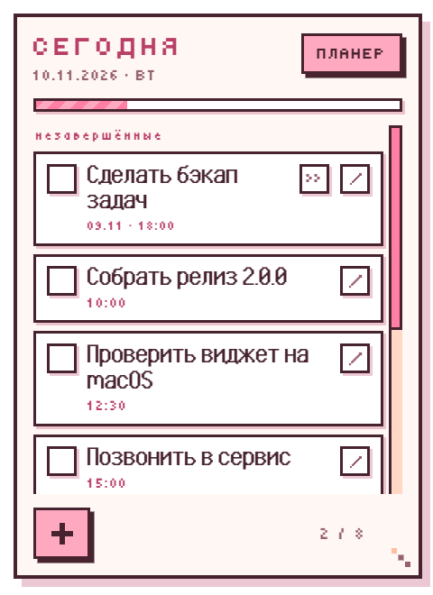
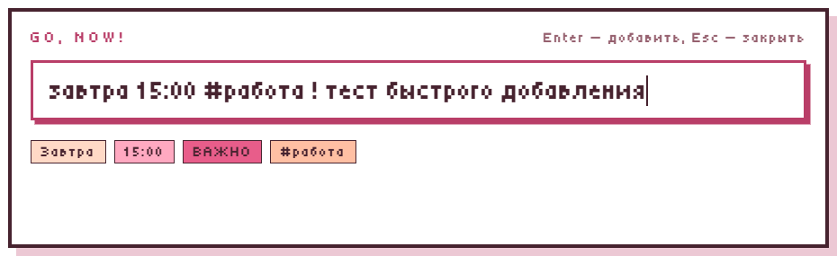
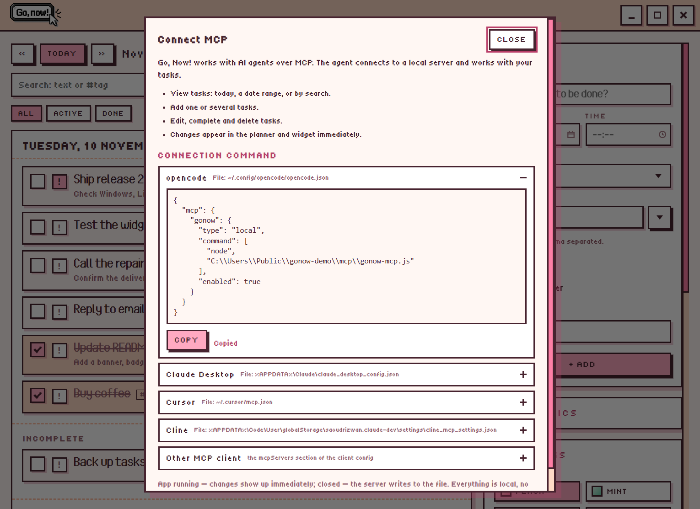
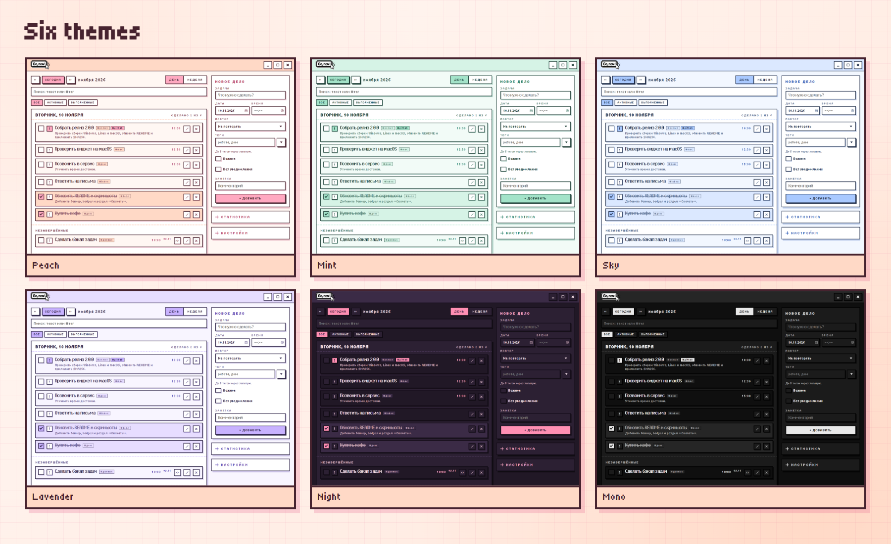

# Go, Now!

[Русский](README.md) | **English**

[](https://github.com/S3MPLAR/Go-Now/releases/latest)
[](#download)
[](LICENSE)
[](#mcp-server)
[](https://github.com/S3MPLAR/Go-Now/releases)

A pixel-art task planner with a desktop widget for Windows, macOS and Linux.
Retro pixel graphics, six color themes, Russian and English UI, local-only data,
and optional AI-assistant integration via MCP.

Version 2.0.0 · Windows 10/11 · Linux · macOS (x64) · MIT

Support the project: [Boosty](https://boosty.to/anc/donate)

## Download

Latest version — [**v2.0.0**](https://github.com/S3MPLAR/Go-Now/releases/latest).

| Platform | Download |
| --- | --- |
| **Windows 10/11 (x64)** | [Installer](https://github.com/S3MPLAR/Go-Now/releases/latest) · [Portable](https://github.com/S3MPLAR/Go-Now/releases/latest) |
| **Linux (x64)** | [AppImage](https://github.com/S3MPLAR/Go-Now/releases/latest) · [deb](https://github.com/S3MPLAR/Go-Now/releases/latest) |
| **macOS (x64)** | [dmg](https://github.com/S3MPLAR/Go-Now/releases/latest) · [zip](https://github.com/S3MPLAR/Go-Now/releases/latest) |

All builds are unsigned: Windows SmartScreen and macOS Gatekeeper may show a
warning on first launch. Checksums are attached to the release
(`SHA256SUMS-*.txt`).

## Screenshots

| Planner | Desktop widget |
| --- | --- |
|  |  |

| Quick add | MCP |
| --- | --- |
|  |  |



## Contents

- [Download](#download)
- [Screenshots](#screenshots)
- [Features](#features)
- [Keyboard shortcuts](#keyboard-shortcuts)
- [Installation](#installation)
- [Data and privacy](#data-and-privacy)
- [MCP server](#mcp-server)
- [Building from source](#building-from-source)
- [Structure](#structure)
- [Limitations](#limitations)
- [Contributing](#contributing)
- [License](#license)

## Features

- **Desktop widget** — on Windows it sits behind the desktop icons (pinned to the
  wallpaper WorkerW layer); on macOS and Linux it is a floating desktop window,
  managed from the tray, with an optional "Always on top". Today's tasks, pixel
  checkboxes with strikethrough, quick add, drag by the header, resize from the
  bottom-right corner (position and size are saved), double-click the header to
  open the planner.
- **Planner window** — day and week views, date navigation, tasks with date,
  time, repeat and note, deletion. Full-screen / restore-window button.
- **Growing note field** — the note input expands as you type so the whole text
  is visible (up to 1000 characters).
- **Task editing** — the pencil button on a task (planner and widget) opens the
  "Current task" form with the same fields; Save updates the task, Cancel returns
  to "New task".
- **Date and time from the widget** — the "Date" button expands date and time
  pickers; without a date the task is created for today.
- **Pixel date picker** — a custom calendar with month navigation, today
  highlight and Today/Clear buttons; time is picked with hour and minute columns
  and a Now button.
- **Global hotkeys** — `Alt+Shift+Q` opens the planner by default, `Ctrl+Alt+Space`
  opens quick add. Both are configurable in settings: click a field to start
  recording (it blinks), the new combination is saved immediately, Esc cancels.
  Each field has a Reset button. The global shortcuts are paused while recording;
  a taken combination shows an error.
- **Quick add** — `Ctrl+Alt+Space` from anywhere: a mini window near the cursor
  understands "tomorrow", "on Monday", "in 3 days", `15:00`, "9 pm", `15.11`,
  `#tags`, `!` (important) and "no date". Chips preview the parse before saving,
  Enter adds, Esc closes.
- **Search and filters** — search across titles, notes and tags on all dates,
  results grouped by day; filters All / Active / Done and a tag filter. Completed
  tasks can be reviewed in the archive and cleared with one button
  (confirmation + undo).
- **Important, tags and order** — the "!" flag lifts a task in the list; up to five
  tags per task, clicking a tag applies a filter; drag to reorder within a day,
  drop onto another day in the week view.
- **Undo** — deleting, completing and clearing the archive show a 6-second toast
  with an Undo button.
- **Statistics** — done today, last 7 days and a day streak; a mini bar chart in
  the side panel.
- **Data safety** — atomic file writes, daily backups in `backups/` (7 kept),
  recovery from `.bak` on corrupt JSON, and optional auto-cleanup of completed
  tasks (off by default). The Folder button opens the data directory.
- **No due date / no reminder** — the "No reminder" flag in the planner and the
  widget's quick add puts a task into the "No due date" section with no date,
  deadline or reminders.
- **Incomplete tasks** — unfinished tasks with a past date are kept in an
  "Incomplete" section (widget and planner) with the due date and a "Move to
  today" button.
- **Widget safety** — position and size are clamped to the work area; on
  monitor/DPI changes the widget is brought back on screen. If Explorer restarts
  or the pin is lost, the widget is recreated/re-pinned automatically.
- **Startup option** — disable opening the planner on launch (widget only).
- **Export / import** — tasks can be saved to and loaded from JSON in settings
  (import replaces the list after confirmation).
- **Repeats** — daily / weekly: completing a task creates the next one.
  Unchecking removes the auto-created copy.
- **Reminders** — a compact popup with a soft chime: task title, note, clickable
  links. "Done" and "+10 min" buttons, auto-snooze after a minute.
- **Tray and autostart** — the app minimizes to the tray; autostart with Windows
  (enabled after installation).
- **Themes** — six palettes: Peach (default), Mint, Sky, Lavender, Night and
  black-and-white Monochrome. Applied to the planner, widget and reminders.
- **Custom logo** — PNG/JPG/WebP: the image is copied to the data folder and
  replaces the logo in the planner header; Reset restores the default.
- **Languages** — Russian and English, switchable in settings.

## Keyboard shortcuts

| Keys | Action |
| --- | --- |
| `Ctrl+Alt+Space` | Quick add from anywhere (default, configurable) |
| `Alt+Shift+Q` | Open/hide the planner (default, configurable) |
| `N` or `Ctrl+N` | New task |
| `/` or `Ctrl+F` | Search |
| `↑` / `↓` | Move between tasks |
| `Space` | Complete / restore |
| `Enter` | Edit task |
| `Delete` | Delete task (with undo) |
| `Esc` | Reset search / close window |

## Installation

**Windows 10/11 (x64)**
1. Download `gonow-2.0.0-setup.exe` (installer) or `gonow-2.0.0-portable.exe`
   (portable, no installation).
2. Run it. The installer installs per-user (no administrator rights) and creates
   desktop and Start menu shortcuts.
3. The planner opens on first launch and the widget appears on the desktop.

**Linux (x64)**
- AppImage: `chmod +x gonow-*-linux-*.AppImage`, then run it.
- Debian/Ubuntu: `sudo apt install ./gonow-*-linux-*.deb`.

**macOS (x64, unsigned)**
- `gonow-*-mac-x64.dmg` or `.zip`.
- Gatekeeper may block the first launch: right-click `Go, Now!.app` → Open, or
  run `xattr -cr "/Applications/Go, Now!.app"`.

Data lives in the app data folder:
- Windows: `%APPDATA%\Go, Now!\pixel-planner.json`
- macOS: `~/Library/Application Support/Go, Now!/pixel-planner.json`
- Linux: `~/.config/Go, Now!/pixel-planner.json`

## Data and privacy

- All tasks, settings and the logo are stored locally in the app data folder
  (Windows: `%APPDATA%\Go, Now!`, macOS: `~/Library/Application Support/Go, Now!`,
  Linux: `~/.config/Go, Now!`).
- The file is written atomically (temp file + rename); on launch a
  `pixel-planner.json.bak` and a daily copy in `backups/` are created (last 7
  kept). If the JSON is corrupt, the app recovers from a backup.
- No telemetry, no network requests. Nothing leaves the machine.
- The optional MCP integration uses only a local HTTP bridge on `127.0.0.1` with
  a random token stored in `bridge.json`.

## MCP server

`mcp/gonow-mcp.js` is a dependency-free stdio MCP server for AI assistants
(opencode and other MCP clients). Tools:

- `list_tasks` — filters `date`, `from`/`to`, `search`, `include_done`;
- `add_task` — one task (including `important` and `tags`);
- `add_tasks` — several tasks in one call;
- `update_task` — edit by `id` (including `done`, `important`, `tags`);
- `delete_task` — delete by `id`.

While the app is running, MCP uses the local HTTP bridge, so changes appear in the
UI immediately. When the app is closed, the server writes to the data file
directly (atomic, with a lock); changes are picked up on the next launch.

The bridge logs requests to the app data folder (`bridge.log`,
`method path status ms`) and exposes `GET /health`. Quick check:
`npm run mcp:smoke`.

opencode configuration (`~/.config/opencode/opencode.json`):

```json
{
  "mcp": {
    "gonow": {
      "type": "local",
      "command": ["node", "<path-to-project>/mcp/gonow-mcp.js"],
      "enabled": true
    }
  }
}
```

Restart opencode after changing the config.

The app ships a ready-made panel: **Settings → Connect MCP**. It shows the correct
server path for the installed version and ready configs for opencode, Claude
Desktop, Cursor, Cline and other clients, with a “Copy” button — no manual
editing required.

## Building from source

```powershell
npm install
npm start          # run
npm test           # store and parser tests
npm run smoke      # app boot check
npm run mcp:smoke  # MCP check (bridge or file mode)
npm run dist:win   # Windows: installer + portable
npm run dist:linux # Linux: AppImage + deb (Linux or CI)
npm run dist:mac   # macOS: dmg + zip (macOS only)
```

The icons `build/icon.png`, `build/icon.icns` and tray icons are committed;
`npm run icons` regenerates them on Windows (PowerShell).

Asset scripts: `npm run brand` (icons and logo from `assets/source/`),
`npm run ico` (multi-size `build/icon.ico`), `npm run winicons` (window icons),
`npm run icons` (PNG/ICNS and tray icons for macOS/Linux).

Cross-platform builds run in GitHub Actions (`.github/workflows/build.yml`):
Windows, Linux and macOS. macOS builds only on a macOS runner.

See [DEVELOPMENT.md](DEVELOPMENT.md) for details.

## Structure

```
main.js              — main process: windows, tray, reminders, IPC, bridge
preload.js           — safe renderer ↔ main bridge
src/store.js         — tasks, repeats, snooze, due-task checks
src/pin.js           — desktop pinning (PowerShell + WorkerW)
src/platform.js      — autostart, tray and paths for Windows/macOS/Linux
.github/workflows/   — CI builds for Windows/Linux/macOS
renderer/widget.*    — desktop widget
renderer/planner.*   — planner window
renderer/quick.*     — quick-add mini window
renderer/reminder.*  — reminder popup
renderer/shared/     — theme, i18n, date/time pickers, quick-add parser
mcp/gonow-mcp.js     — MCP server
scripts/             — asset generation, tests, smoke tests
assets/source/       — icon and logo sources
build/icon.ico       — installer icon
```

## Limitations

- The build is not code-signed: Windows SmartScreen may warn on first launch.
- The macOS build is also unsigned: Gatekeeper may require right-click → Open or
  `xattr -cr`.
- No auto-update — download and install new versions manually.
- Desktop pinning behind icons is Windows-only (`WorkerW`). On macOS and Linux
  the widget is a floating desktop window, managed from the tray, with an
  optional "Always on top".
- On Linux, global hotkeys and the tray depend on the desktop environment: X11 is
  the most reliable; some features may be unavailable on Wayland.
- The AppImage requires `libfuse2`; without it run with `--appimage-extract-and-run`.
- The Windows portable build keeps data in `%APPDATA%` (not next to the `.exe`).
- The notification sound is a soft Web Audio chime, no external files.

## Contributing

Bugs and feature requests: [Issues](https://github.com/S3MPLAR/Go-Now/issues).
Before a PR, see [DEVELOPMENT.md](DEVELOPMENT.md) and the
[PR template](.github/pull_request_template.md). For security issues, follow
[SECURITY.md](SECURITY.md).

## License

Code and original assets are [MIT](LICENSE), © 2026 Alexander Ancibor.

Pixel Ultima and Tiny5 fonts are distributed under the SIL Open Font License 1.1;
full texts are in `renderer/assets/fonts/licenses/`. See
[THIRD_PARTY_NOTICES.md](THIRD_PARTY_NOTICES.md).

If you find the project useful, you can support development on
[Boosty](https://boosty.to/anc/donate).
