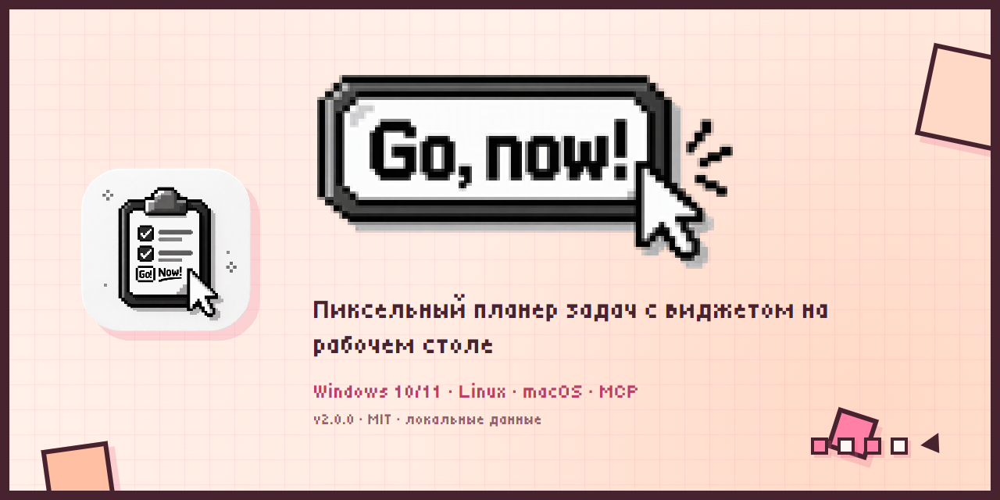
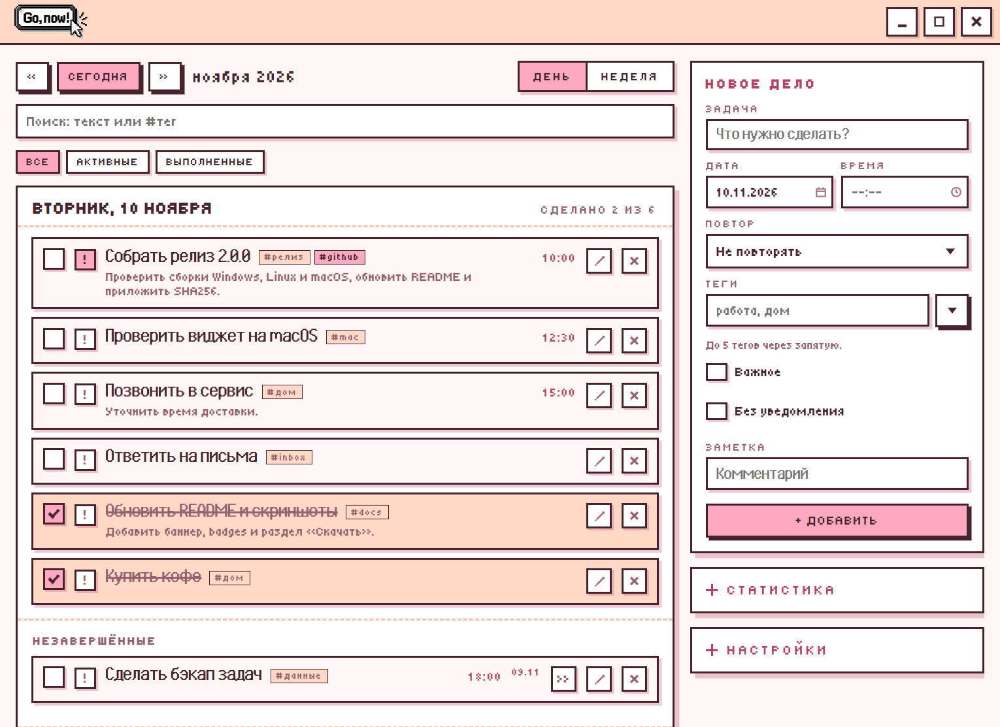
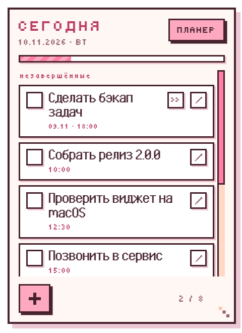
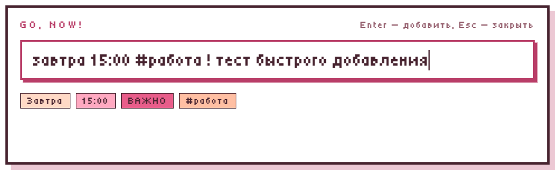
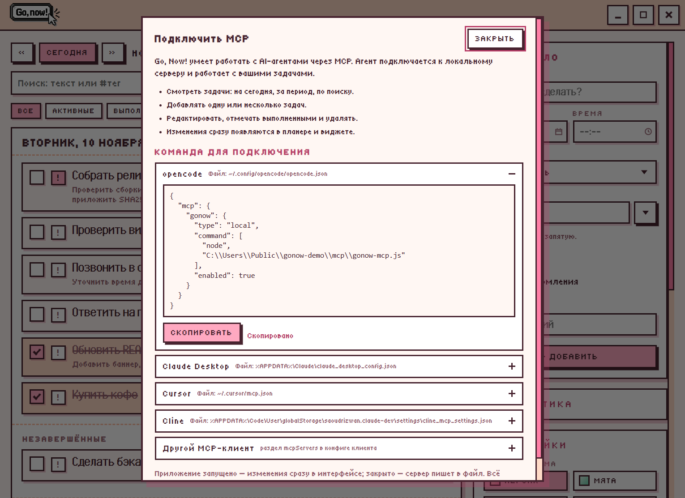
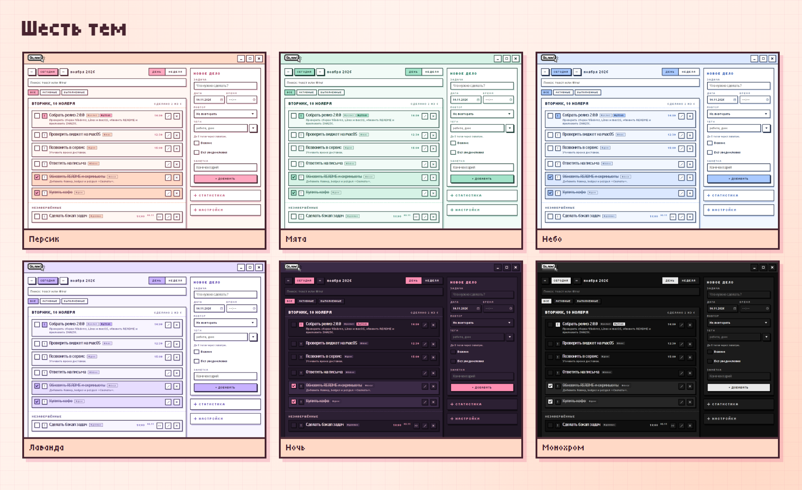

# Go, Now!

**Русский** | [English](README.en.md)

[](https://github.com/S3MPLAR/Go-Now/releases/latest)
[](#скачать)
[](LICENSE)
[](#mcp-сервер)

Пиксельный планер задач с виджетом прямо на рабочем столе Windows, macOS и Linux.
Ретро-пиксельная графика, шесть цветовых тем, русский и английский интерфейс,
локальное хранение данных и необязательная интеграция с AI-ассистентом через MCP.

Версия 2.0.0 · Windows 10/11 · Linux · macOS (x64) · MIT

Поддержать проект: [Boosty](https://boosty.to/anc/donate)

## Скачать

Последняя версия — [**v2.0.0**](https://github.com/S3MPLAR/Go-Now/releases/latest).

| Платформа | Скачать |
| --- | --- |
| **Windows 10/11 (x64)** | [Установщик](https://github.com/S3MPLAR/Go-Now/releases/latest) · [Portable](https://github.com/S3MPLAR/Go-Now/releases/latest) |
| **Linux (x64)** | [AppImage](https://github.com/S3MPLAR/Go-Now/releases/latest) · [deb](https://github.com/S3MPLAR/Go-Now/releases/latest) |
| **macOS (x64)** | [dmg](https://github.com/S3MPLAR/Go-Now/releases/latest) · [zip](https://github.com/S3MPLAR/Go-Now/releases/latest) |

Все сборки не подписаны: Windows SmartScreen и macOS Gatekeeper могут показать
предупреждение при первом запуске. Контрольные суммы — в ассетах релиза
(`SHA256SUMS-*.txt`).

## Скриншоты

| Планер | Виджет на рабочем столе |
| --- | --- |
|  |  |

| Быстрое добавление | MCP |
| --- | --- |
|  |  |



## Содержание

- [Скачать](#скачать)
- [Скриншоты](#скриншоты)
- [Возможности](#возможности)
- [Горячие клавиши](#горячие-клавиши)
- [Установка](#установка)
- [Данные и приватность](#данные-и-приватность)
- [MCP-сервер](#mcp-сервер)
- [Сборка из исходников](#сборка-из-исходников)
- [Структура](#структура)
- [Ограничения](#ограничения)
- [Участие](#участие)
- [Лицензия](#лицензия)

## Возможности

- **Виджет на рабочем столе** — в Windows живёт за иконками (крепится к слою
  обоев через WorkerW); в macOS и Linux — плавающее окно на рабочем столе,
  управляется из трея, опционально «Поверх окон». Список дел на сегодня,
  чекбоксы с вычёркиванием, быстрый «+», перетаскивание за шапку, изменение
  размера за правый нижний угол (позиция и размер сохраняются), двойной клик по
  шапке открывает планер.
- **Окно-планер** — виды «день» и «неделя», навигация по датам, добавление задач
  с датой, временем, повтором и заметкой, удаление. Кнопка «во весь экран /
  свернуть в окно».
- **Заметка растёт** — поле заметки увеличивается по мере ввода, чтобы был виден
  весь текст (до 1000 символов).
- **Редактирование задач** — карандаш на задаче (в планере и виджете) открывает
  форму «Текущее дело» с теми же полями; сохранение обновляет задачу, «Отмена»
  возвращает форму «Новое дело».
- **Дата и время из виджета** — кнопка «Дата» раскрывает выбор даты и времени;
  без даты задача создаётся на сегодня.
- **Пиксельный календарь** — вместо системных пикеров: календарь с навигацией по
  месяцам, подсветкой сегодняшнего дня и кнопками «Сегодня/Сброс»; для времени —
  колонки часов и минут с кнопкой «Сейчас».
- **Горячие клавиши** — по умолчанию `Alt+Shift+Q` открывает планер, а
  `Ctrl+Alt+Space` — быстрое добавление. Обе комбинации настраиваются в
  параметрах: клик по полю начинает запись (поле мигает), новое сочетание сразу
  сохраняется, Esc отменяет. Рядом есть кнопка «Сброс». Пока идёт запись,
  глобальные клавиши временно отключены; если комбинация занята, показывается
  ошибка.
- **Быстрое добавление** — `Ctrl+Alt+Space` из любого места: мини-окно у курсора
  распознаёт «завтра», «в понедельник», «через 3 дня», `15:00`, «в 9 вечера»,
  `15.11`, `#теги`, `!` (важное) и «без срока». Чипы показывают разбор до
  сохранения, Enter добавляет, Esc закрывает.
- **Поиск и фильтры** — поиск по заголовку, заметке и тегам сразу по всем датам,
  результаты сгруппированы по дням; фильтры «Все / Активные / Выполненные» и
  фильтр по тегу. Выполненные можно посмотреть в архиве и очистить одной кнопкой
  (с подтверждением и отменой).
- **Важное, теги и порядок** — флаг «!» поднимает задачу в списке; до пяти тегов
  на задачу, клик по тегу включает фильтр; перетаскивание меняет порядок внутри
  дня, в недельном виде задачу можно перенести на другой день.
- **Отмена действий** — удаление, выполнение и очистка архива показывают тост с
  кнопкой «Отменить» на 6 секунд.
- **Статистика** — сделано сегодня, за 7 дней и серия дней подряд; мини-график по
  дням в боковой панели.
- **Надёжность данных** — атомарная запись файла, ежедневные резервные копии в
  `backups/` (хранятся 7), восстановление из `.bak` при повреждении JSON и
  настраиваемая автоочистка выполненных (по умолчанию выключена). Кнопка «Папка»
  открывает каталог данных.
- **Без срока и уведомления** — флаг «Без уведомления» в планере и в быстром
  добавлении виджета: задача попадает в раздел «Без срока», без даты, дедлайна и
  напоминаний.
- **Незавершённые** — невыполненные задачи с прошедшей датой не теряются: в
  виджете и планере есть раздел «Незавершённые» с датой срока и кнопкой
  «На сегодня».
- **Защита виджета** — позиция и размер ограничиваются рабочей областью; при смене
  мониторов/DPI виджет возвращается на экран. Если Explorer перезапустился или
  закрепление потерялось, виджет пересоздаётся/перекрепляется автоматически.
- **Настройка запуска** — можно отключить автооткрытие планера при старте (только
  виджет).
- **Экспорт и импорт** — задачи сохраняются/загружаются в JSON из настроек
  (импорт заменяет список после подтверждения).
- **Повторы** — «каждый день» / «каждую неделю»: после выполнения создаётся
  следующее дело. Снятие галочки убирает автоматически созданную копию.
- **Напоминания** — компактная всплывашка с мягким звуковым сигналом: название
  задачи, комментарий, кликабельные ссылки. Кнопки «Сделано» и «+10 мин»,
  автоотсрочка через минуту.
- **Трей и автозапуск** — приложение сворачивается в трей; автозапуск с Windows
  (включается после установки).
- **Оформление** — шесть тем: «Персик» (по умолчанию), «Мята», «Небо», «Лаванда»,
  «Ночь» и чёрно-белая «Монохром». Тема применяется к планеру, виджету и
  напоминаниям.
- **Свой логотип** — PNG/JPG/WebP: картинка копируется в папку данных и заменяет
  логотип в шапке планера; «Сброс» возвращает стандартный.
- **Языки** — русский и английский: переключатель «РУС / ENG» в настройках.

## Горячие клавиши

| Клавиши | Действие |
| --- | --- |
| `Ctrl+Alt+Space` | Быстрое добавление из любого места (по умолчанию, настраивается) |
| `Alt+Shift+Q` | Открыть/скрыть планер (по умолчанию, настраивается) |
| `N` или `Ctrl+N` | Новая задача |
| `/` или `Ctrl+F` | Поиск |
| `↑` / `↓` | Перемещение по задачам |
| `Space` | Отметить выполненной / вернуть |
| `Enter` | Редактировать задачу |
| `Delete` | Удалить задачу (с отменой) |
| `Esc` | Сбросить поиск / закрыть окно |

## Установка

**Windows 10/11 (x64)**
1. Скачайте `gonow-2.0.0-setup.exe` (установщик) или `gonow-2.0.0-portable.exe`
   (портативная версия без установки).
2. Запустите. Установщик ставит приложение для текущего пользователя, без прав
   администратора, и создаёт ярлыки на рабочем столе и в меню «Пуск».
3. При первом запуске открывается планер, виджет появляется на рабочем столе.

**Linux (x64)**
- AppImage: `chmod +x gonow-*-linux-*.AppImage`, затем запустите файл.
- Debian/Ubuntu: `sudo apt install ./gonow-*-linux-*.deb`.

**macOS (x64, без подписи)**
- `gonow-*-mac-x64.dmg` или `.zip`.
- При первом запуске Gatekeeper может заблокировать приложение: правый клик по
  `Go, Now!.app` → «Открыть», либо `xattr -cr "/Applications/Go, Now!.app"`.

Данные хранятся в папке приложения:
- Windows: `%APPDATA%\Go, Now!\pixel-planner.json`
- macOS: `~/Library/Application Support/Go, Now!/pixel-planner.json`
- Linux: `~/.config/Go, Now!/pixel-planner.json`

## Данные и приватность

- Все задачи, настройки и логотип хранятся локально в папке данных приложения
  (Windows: `%APPDATA%\Go, Now!`, macOS: `~/Library/Application Support/Go, Now!`,
  Linux: `~/.config/Go, Now!`).
- Файл записывается атомарно (временный файл + переименование), при запуске
  создаётся `pixel-planner.json.bak`, а также ежедневная копия в `backups/`
  (последние 7). При повреждении JSON приложение восстанавливается из копии.
- Телеметрии и сетевых запросов нет. Наружу ничего не отправляется.
- MCP-интеграция (необязательная) использует только локальный HTTP-мост
  `127.0.0.1` со случайным токеном в `bridge.json`.

## MCP-сервер

`mcp/gonow-mcp.js` — stdio MCP-сервер без зависимостей для AI-ассистентов
(opencode и других MCP-клиентов). Инструменты:

- `list_tasks` — фильтры `date`, `from`/`to`, `search`, `include_done`;
- `add_task` — одна задача (включая `important` и `tags`);
- `add_tasks` — несколько задач одним вызовом;
- `update_task` — правка по `id` (включая `done`, `important`, `tags`);
- `delete_task` — удаление по `id`.

Пока приложение запущено, MCP работает через локальный HTTP-мост: изменения сразу
появляются в интерфейсе. Если приложение закрыто, сервер пишет напрямую в файл
данных (атомарно, с блокировкой) — изменения подхватятся при следующем запуске.

Мост пишет журнал в папке данных приложения (`bridge.log`, `метод путь статус мс`)
и отдаёт `GET /health`. Быстрая проверка: `npm run mcp:smoke`.

Подключение в opencode (`~/.config/opencode/opencode.json`):

```json
{
  "mcp": {
    "gonow": {
      "type": "local",
      "command": ["node", "<path-to-project>/mcp/gonow-mcp.js"],
      "enabled": true
    }
  }
}
```

После изменения конфига перезапустите opencode.

В приложении есть готовая панель: **Настройки → Подключить MCP**. Она показывает
правильный путь к серверу для установленной версии и готовые конфиги для
opencode, Claude Desktop, Cursor, Cline и других клиентов — с кнопкой
«Скопировать». Ничего вводить вручную не нужно.

## Сборка из исходников

```powershell
npm install
npm start          # запуск
npm test           # тесты стора и парсера
npm run smoke      # проверка загрузки приложения
npm run mcp:smoke  # проверка MCP (мост или файл)
npm run dist:win   # Windows: установщик + portable
npm run dist:linux # Linux: AppImage + deb (Linux или CI)
npm run dist:mac   # macOS: dmg + zip (только на macOS)
```

Иконки `build/icon.png`, `build/icon.icns` и иконки трея уже в репозитории;
`npm run icons` пересобирает их на Windows (PowerShell).

Скрипты сборки ассетов: `npm run brand` (иконки и логотип из `assets/source/`),
`npm run ico` (мультиразмерный `build/icon.ico`), `npm run winicons` (иконки кнопок),
`npm run icons` (PNG/ICNS и иконки трея для macOS/Linux).

Кроссплатформенные сборки выполняются в GitHub Actions
(`.github/workflows/build.yml`): Windows, Linux и macOS. macOS собирается только
на macOS-раннере.

Подробности для разработки — в [DEVELOPMENT.md](DEVELOPMENT.md).

## Структура

```
main.js              — главный процесс: окна, трей, напоминания, IPC, мост
preload.js           — безопасный мост renderer ↔ main
src/store.js         — задачи, повторы, snooze, проверка «пора напоминать»
src/pin.js           — закрепление виджета к рабочему столу (PowerShell + WorkerW)
src/platform.js      — автозапуск, трей и пути для Windows/macOS/Linux
.github/workflows/   — CI-сборки Windows/Linux/macOS
renderer/widget.*    — виджет на столе
renderer/planner.*   — окно-планер
renderer/quick.*     — мини-окно быстрого добавления
renderer/reminder.*  — всплывашка-напоминалка
renderer/shared/     — тема, переводы (i18n.js), пикеры дат (picker.*),
                       парсер быстрого добавления (quick-parse.js)
mcp/gonow-mcp.js     — MCP-сервер
scripts/             — сборка ассетов, тесты, смоук-тесты
assets/source/       — исходники иконки и логотипа
build/icon.ico       — иконка для установщика
```

## Ограничения

- Код не подписан сертификатом: Windows SmartScreen может показать предупреждение
  при первом запуске установщика.
- macOS-сборка также не подписана: Gatekeeper может потребовать правый клик →
  «Открыть» или `xattr -cr`.
- Автообновления нет — новую версию нужно скачать и установить вручную.
- Закрепление виджета за иконками доступно только в Windows (`WorkerW`). На macOS
  и Linux виджет — плавающее окно на рабочем столе; им можно управлять из трея,
  опционально «Поверх окон».
- На Linux глобальные горячие клавиши и трей зависят от окружения: надёжнее всего
  X11; на Wayland часть функций может быть недоступна.
- AppImage требует `libfuse2`; без него запускайте с `--appimage-extract-and-run`.
- Портативная версия Windows хранит данные в `%APPDATA%` (не рядом с `.exe`).
- Звук — мягкий одиночный сигнал (Web Audio), без внешних файлов.

## Участие

Баги и предложения — через [Issues](https://github.com/S3MPLAR/Go-Now/issues).
Перед PR загляните в [DEVELOPMENT.md](DEVELOPMENT.md) и
[шаблон PR](.github/pull_request_template.md). Об уязвимостях — по инструкции
в [SECURITY.md](SECURITY.md).

## Лицензия

Код и оригинальные ассеты — [MIT](LICENSE), © 2026 Alexander Ancibor.

Шрифты Pixel Ultima и Tiny5 распространяются по SIL Open Font License 1.1;
полные тексты — в `renderer/assets/fonts/licenses/`. См.
[THIRD_PARTY_NOTICES.md](THIRD_PARTY_NOTICES.md).

Если проект оказался полезен — можно поддержать разработку на
[Boosty](https://boosty.to/anc/donate).
